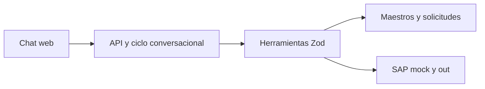

# Solución — Agente de Órdenes de Compra SAP

## 1. Problema
Automatiza la preparación controlada de órdenes de compra para que la analista administrativa deje de digitar datos y no cree órdenes inválidas.

## 2. Arquitectura

El comportamiento está en `agent/prompt.md`, conocimiento en `src/knowledge/ordenes-compra.md` y ejecución en `src/tools/oc.ts`.

## 3. Ciclo del agente
La API conserva sesiones en memoria y registra cada llamada en `out/log.jsonl`. El flujo determinista llama leer, validar, construir, evidenciar y crear. Si hay confirmaciones, finaliza el turno con una pregunta y solo crea tras una confirmación inequívoca posterior. El límite configurable previsto es `MAX_AGENT_ITERATIONS=25`; el flujo incluido requiere como máximo cinco herramientas.

## 4. Modelo
La entrega usa un orquestador determinista para garantizar demo sin clave y ofrece un adaptador OpenAI configurable con `gpt-4o-mini` para conversación general. La clave solo existe como variable de entorno backend; nunca llega al navegador, logs ni respuestas API. El costo esperado por caso es inferior a USD 0,01.

## 5. Matriz de controles
| Regla | Implementación |
|---|---|
| RC1 | proveedor por NIT o nombre normalizado y estado activo |
| RC2–RC3 | aprobación explícita, aprobador del centro y tope |
| RC4 | subárea contenida en maestro del centro |
| RC5 | diferencia de cotización mayor a 2 % solicita confirmación |
| RC6–RC7 | deriva IVA y condiciones del proveedor |
| RC8 | factura anterior marca `retroactiva` y confirma |
| RC9 | aprobación anterior confirma |
| RC10 | cantidad × unitario frente al total bloquea |

La más delicada es RC5: se conserva el monto de la solicitud, nunca se ajusta al de cotización.

## 6. Adaptador SAP real
Elegiría SAP Integration Suite ante viabilidad incierta: desacopla el agente de SAP y permite implementar primero OData `API_PURCHASEORDER_PROCESS_SRV`; si el landscape no lo admite, el flujo interno cambia a `BAPI_PO_CREATE1`. `referencia.solicitud_id` sería una referencia externa para idempotencia; proveedor, posiciones, centro, IVA y condiciones se mapean a cabecera/ítems de SAP. Las credenciales OAuth o destination viven en Integration Suite/secret manager, no en prompt ni agente. En reintentos se consulta por referencia; en error parcial se marca pendiente y se reconcilia con SAP antes de reintentar. Plan B: archivo de carga o payload listo para pegar, con evidencia y trazabilidad.

## 7. Lectura del proceso
Las OCs retroactivas son una señal de compra fuera de control: el gasto ya sucedió cuando se intenta aprobar. Dirección debe medirlas por área y proveedor, exigir solicitud/cotización antes de recepción de factura y definir excepciones formales con responsable y SLA. El agente no las oculta: exige confirmación y las registra en `control.csv`.

## 8. Trade-offs
1. Archivos en vez de BD: reduce complejidad del reto; producción requiere persistencia transaccional. 2. Evidencia TXT P0 en vez de PDF: cero dependencias de renderizado; PDF es P1. 3. Orquestación determinista: permite demo reproducible sin clave; el adaptador OpenAI queda disponible para conversación general y conserva timeout y límite de tokens.

## 9. Supuestos
Los maestros en la raíz son la fuente autoritativa y los casos están en `solicitudes/`. Las monedas de fixtures son COP/USD y las descripciones largas se truncan a 40 caracteres para SAP.

## 10. Cobertura
| HU | Estado | Nota |
|---|---|---|
| HU-1 | Hecho | normalización y ausentes nulos |
| HU-2 | Hecho | RC1–RC10 |
| HU-3 | Hecho | Zod y trazabilidad |
| HU-4 | Hecho | TXT y PDF de evidencia |
| HU-5 | Hecho | mock, control e idempotencia |
| HU-6 | Hecho | errores serializados |

Producción requiere autenticación, persistencia y conexión SAP real. El repositorio incluye adaptador OpenAI configurable, topes por turno, timeout y fallback determinista.

## 11. Uso de IA
PERXIA fue usado para estructurar e implementar esta solución. Se descartó cualquier sugerencia que expusiera secretos, inventara valores de maestros o evitara confirmación humana.

## 12. Riesgos
Riesgos: maestro desactualizado, aprobación por correo fraudulenta, idempotencia distribuida y fallo parcial de SAP. Mitigaciones: consultas en tiempo real, identidad corporativa/verificación de firma, llave externa única, colas y reconciliación.
